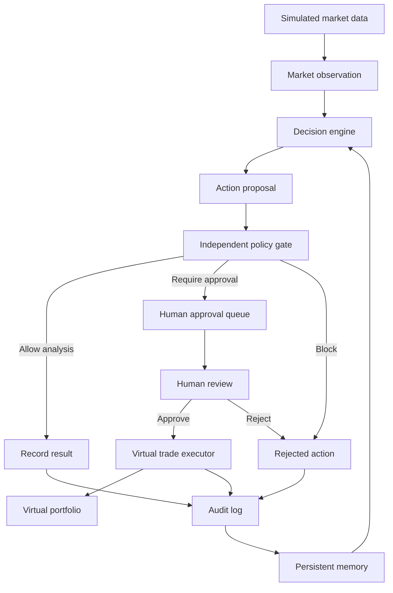

# Aureus — Governed Autonomous Market Agent

Aureus is a Python-based autonomous market research agent that operates entirely within a simulated environment.

The project demonstrates how an agent can repeatedly observe market data, make explainable decisions, remember previous cycles, propose portfolio actions, enforce independent policies, request human approval, and update a virtual portfolio without using real money.

> **Important:** This project is for education and demonstration only. It does not provide financial advice, connect to a brokerage account, or execute real financial transactions.

## Project Goals

This project was created to explore:

- Autonomous agent design
- Explainable market decisions
- Policy-based AI governance
- Human-in-the-loop approvals
- Persistent agent memory
- Tamper-evident audit logging
- Virtual portfolio management
- Controlled action execution
- Safe continuous operation

Aureus has a distinctive identity, but it does not claim to be human or conscious. Its decisions are deterministic and based on programmed rules applied to fictional market data.

## Current Capabilities

Aureus can:

- Load a governed identity and operating policy
- Analyze deterministic simulated market data
- Classify price trends, sentiment, and volatility
- Produce explainable BUY, HOLD, WATCH, or AVOID recommendations
- Use previous cycles as decision context
- Convert recommendations into action proposals
- Pass every proposal through an independent policy gate
- Block unknown or prohibited actions by default
- Queue virtual BUY proposals for human approval
- Prevent duplicate pending approval requests
- Accept explicit approval or rejection through a CLI
- Execute approved virtual BUY orders
- Prevent an approval from being reused
- Enforce trade-size and position-size limits
- Maintain a persistent virtual portfolio
- Create a hash-linked, tamper-evident audit trail
- Run one cycle, multiple cycles, or continuously
- Record runner failures and shutdown status
- Stop safely when interrupted with `Ctrl+C`

## Safety Boundaries

The governing policy prohibits Aureus from:

- Using real money
- Executing real financial transactions
- Accessing cryptocurrency wallets
- Requesting or storing credentials
- Publishing to public accounts without approval
- Disabling audit logging
- Modifying its governing policy
- Modifying its own identity or goals
- Executing operating-system commands

Unknown actions are blocked by default.

The policy currently limits virtual activity to:

- Starting virtual cash: `$100,000`
- Maximum virtual trade: `$5,000`
- Maximum position size: `20%`
- Minimum autonomous-cycle interval: `60 seconds`

## Architecture



## Autonomous Cycle

Each autonomous cycle performs the following steps:

1. Load the agent identity and governing policy.
2. Load persistent memory from earlier cycles.
3. Read the fictional market history.
4. Create a market observation.
5. Generate explainable recommendations.
6. Add historical memory context.
7. Convert recommendations into proposed actions.
8. Evaluate every proposal through the policy gate.
9. Add approval-required trades to the approval queue.
10. Save the latest cycle state.
11. Update persistent memory.
12. Append a tamper-evident audit record.

The autonomous runner repeats this process while preserving the same policy boundaries.

## Technology

- Python 3.13
- JSON configuration and persistent state
- CSV simulated market data
- Pytest
- SHA-256 audit-chain and proposal fingerprints
- Git and GitHub

The project currently uses Python’s standard library plus development dependencies listed in `requirements.txt`.

## Project Structure

```text
governed-autonomous-market-agent/
├── config/
│   ├── agent_identity.json
│   └── agent_policy.json
├── data/
│   ├── market/
│   │   └── market_history.csv
│   └── state/
├── logs/
├── reports/
├── src/
│   ├── agent_cycle.py
│   ├── approval_queue.py
│   ├── approved_trade_workflow.py
│   ├── audit_log.py
│   ├── autonomous_runner.py
│   ├── config_loader.py
│   ├── decision_engine.py
│   ├── demo_approved_trade.py
│   ├── generate_market_data.py
│   ├── memory.py
│   ├── memory_context.py
│   ├── observe_market.py
│   ├── policy_gate.py
│   ├── portfolio.py
│   ├── review_approvals.py
│   └── trade_executor.py
├── tests/
├── README.md
└── requirements.txt
```

Runtime files under `data/state/` and `logs/` are generated locally and are not intended to be committed as source code.

## Installation

Clone the repository and enter the project directory:

```bash
git clone https://github.com/jonevans-tech/governed-autonomous-market-agent.git
cd governed-autonomous-market-agent
```

Create and activate a virtual environment:

```bash
python3 -m venv .venv
source .venv/bin/activate
```

Install the dependencies:

```bash
python -m pip install -r requirements.txt
```

## Run One Governed Cycle

```bash
python -m src.agent_cycle
```

The cycle will:

- Analyze the simulated market
- Generate recommendations
- Apply memory context
- Pass proposals through the policy gate
- Update agent memory
- Write an audit record
- Execute no real financial activity

## Run Autonomously

Run one cycle:

```bash
python -m src.autonomous_runner --cycles 1
```

Run five cycles with the policy-minimum interval:

```bash
python -m src.autonomous_runner \
  --cycles 5 \
  --interval 60
```

Run continuously:

```bash
python -m src.autonomous_runner \
  --continuous \
  --interval 60
```

Press `Ctrl+C` to stop continuous mode safely.

Continuous mode means the Python process remains active while the computer is running. It does not automatically make the program a permanent cloud service.

## Inspect Individual Components

Generate the fictional market data:

```bash
python -m src.generate_market_data
```

Observe the market:

```bash
python -m src.observe_market
```

Create recommendations:

```bash
python -m src.decision_engine
```

Demonstrate the policy gate:

```bash
python -m src.policy_gate
```

Inspect persistent memory:

```bash
python -m src.memory
```

Inspect the virtual portfolio:

```bash
python -m src.portfolio
```

Inspect the approval queue:

```bash
python -m src.approval_queue
```

Verify the audit chain:

```bash
python -c "from src.audit_log import verify_audit_chain; print('Audit chain valid:', verify_audit_chain())"
```

## End-to-End Approved Trade Demonstration

The demonstration creates a simulation-only MED BUY proposal for `$2,500`.

### 1. Prepare the request

```bash
python -m src.demo_approved_trade
```

The output provides:

- An approval ID
- A simulated execution price
- A `REQUIRE_APPROVAL` policy result
- Confirmation that no trade has executed

### 2. Review pending requests

```bash
python -m src.review_approvals list
```

### 3. Approve the request

Replace `<APPROVAL_ID>` with the generated identifier:

```bash
python -m src.review_approvals approve \
  --approval-id <APPROVAL_ID> \
  --reviewer "Your Name" \
  --note "Approved for the simulated demonstration."
```

A request can also be rejected:

```bash
python -m src.review_approvals reject \
  --approval-id <APPROVAL_ID> \
  --reviewer "Your Name" \
  --note "Rejected during human review."
```

### 4. Execute the approved virtual trade

Replace `<APPROVAL_ID>` and `<PRICE>` with the displayed values:

```bash
python -m src.approved_trade_workflow \
  --approval-id <APPROVAL_ID> \
  --price <PRICE>
```

### 5. Inspect the portfolio

```bash
python -m src.portfolio
```

The successful demonstration updates the virtual cash balance, creates a position, records a transaction, and consumes the approval.

Attempting to reuse the same approval produces a clean rejection and does not change the portfolio.

## Testing

Run the complete test suite:

```bash
python -m pytest -v
```

Current test coverage includes:

- Agent identity boundaries
- Policy configuration
- Configuration loading
- Simulated market generation
- Market observations
- Explainable decisions
- Policy-gate enforcement
- Autonomous cycles
- Persistent memory
- Memory-aware reasoning
- Audit-chain integrity
- Virtual portfolio valuation
- Trade execution controls
- Approval queue behavior
- Approval fingerprint validation
- One-time approval consumption
- Approved-trade workflow
- Human approval CLI
- Autonomous runner behavior
- End-to-end demonstration logic
- Clean CLI rejection handling

At the time of this README update, the complete suite contains **167 passing tests**.

## Key Governance Design Decisions

### Independent enforcement

The decision engine does not enforce its own permissions. Proposed actions are evaluated separately by the policy gate.

### Deny by default

Missing, malformed, unknown, real-money, or prohibited requests are rejected.

### Human approval

A BUY recommendation does not execute automatically. The proposal enters a persistent queue and requires an explicit human decision.

### Proposal fingerprinting

Each approval is connected to a SHA-256 fingerprint of the original proposal. Modifying an approved proposal invalidates the authorization.

### One-time approval

An approval is consumed after successful execution and cannot authorize a second transaction.

### Immutable inputs

Core workflow functions use copies so failed actions do not unexpectedly modify the original portfolio or queue.

### Auditability

Cycle records are linked through hashes. Modifying or removing a prior record breaks audit-chain verification.

## Current Limitations

- All companies and prices are fictional.
- Market history is static until regenerated.
- Decisions use programmed rules rather than predictive investment models.
- Only virtual BUY execution is implemented.
- Human approval is performed through a local command-line interface.
- Runtime state is stored in local JSON files.
- The audit chain is tamper-evident, not externally immutable.
- The runner stops when the computer or terminal process stops.
- There is no live market-data or brokerage connection.
- Real-money activity is explicitly prohibited.

## Roadmap to a Real-World Paper-Trading Agent

The next safe step would be broker-supported **paper trading**, not real-money trading.

### Phase 1 — Live read-only market data

- Add a market-data provider adapter.
- Normalize quotes, timestamps, symbols, and trading calendars.
- Detect missing, delayed, duplicated, or stale data.
- Preserve the existing simulated-data adapter for testing.
- Record the source and timestamp of every market observation.

### Phase 2 — Broker paper-trading adapter

- Open a broker-provided paper-trading account.
- Create a broker interface separate from the decision engine.
- Allow only the broker’s simulated or sandbox endpoint.
- Confirm account type before every order.
- Reject the request if the account cannot be proven to be paper-only.
- Store order IDs and broker responses in the audit trail.

### Phase 3 — Secure credential management

- Never place API keys in source code or Git.
- Store secrets in environment variables or a managed secret service.
- Give the agent only the minimum permissions needed.
- Use separate read-only data and paper-trading credentials.
- Rotate credentials and document revocation procedures.
- Prevent secrets from appearing in logs or error messages.

### Phase 4 — Stronger risk controls

Add independent controls for:

- Maximum order value
- Maximum position value
- Maximum daily loss
- Maximum total exposure
- Maximum number of daily trades
- Approved symbol list
- Market-hours validation
- Stale-price rejection
- Duplicate-order prevention
- Unexpected volatility
- Trading halts
- Excessive slippage
- Emergency kill switch

Risk controls should remain outside the decision engine so the agent cannot override them.

### Phase 5 — Order lifecycle and reconciliation

A production-style paper system should track:

- Proposed
- Pending approval
- Approved
- Submitted
- Partially filled
- Filled
- Canceled
- Rejected
- Reconciled

The system should compare local records with the broker after every order and stop automatically when balances, positions, or order status do not match.

### Phase 6 — Monitoring and deployment

Possible deployment targets include a small cloud virtual machine, container service, or scheduled job.

A deployed version would need:

- Process supervision
- Health checks
- Centralized logs
- Failure alerts
- Secure backups
- Time synchronization
- Dependency pinning
- Automated tests before deployment
- A manual shutdown procedure
- Recovery procedures after outages

The service should start in read-only mode and require explicit authorization before paper-order submission is enabled.

### Phase 7 — Extended paper validation

Before considering any real-money connection:

- Run paper trading for an extended period.
- Test normal and abnormal market conditions.
- Simulate missing data and service failures.
- Test duplicate requests and delayed responses.
- Measure drawdowns, volatility, and slippage.
- Review every proposed and executed action.
- Verify that the kill switch works.
- Perform independent security and code reviews.

### Phase 8 — Real-money readiness review

Real-money capability should be treated as a separate project, not a configuration switch.

It would require:

- Legal and regulatory review
- Broker terms-of-service review
- Tax and recordkeeping planning
- Security assessment
- Independent risk review
- Capital-loss limits
- Human approval for every order
- Reconciliation and monitoring
- Incident-response procedures
- A tested emergency shutdown mechanism

Even after those steps, autonomous real-money execution would create substantial financial and operational risk. A safer design would retain human approval and use the agent as a decision-support system rather than giving it unrestricted control of funds.

## Portfolio Value

This project demonstrates practical experience with:

- Python application design
- Autonomous workflows
- AI governance concepts
- Financial control design
- Human-in-the-loop systems
- Policy enforcement
- Risk management
- Persistent state
- Auditability
- Test-driven development
- Failure handling
- Git-based incremental development

## Author

Jon Evans
GitHub: [jonevans-tech](https://github.com/jonevans-tech)

## Disclaimer

This software is an educational simulation. It is not investment advice, a recommendation to buy or sell securities, or a production trading system. No component should be connected to real financial accounts without professional legal, security, compliance, and risk review.
